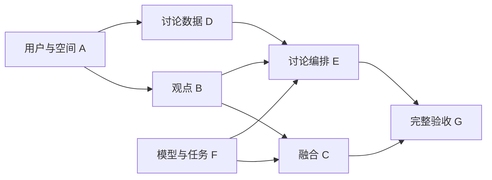

# ThinkSpace 后端工程规划与工作量认领

日期：2026-11-15。状态：待团队认领与评审。

本文从产品目标独立设计，不依据现有后端提交，也不代表任何模块已实现。队友可按模块或子任务自行认领；技术栈由认领者协商统一。

## 1. 第一版目标

完成一条可持久化、可恢复的体验链路：

**保存想法 → 浏览泡泡 → 融合观点 → 围桌讨论 → 将讨论成果保存为新想法。**

第一版完成标准：用户能保存自己的想法；融合得到有来源关系的新观点；参与可中断、可恢复的角色讨论；刷新后数据仍在；不同用户的私有内容相互隔离。

前端负责泡泡游动、挤压和融合动画，以及角色骨骼、镜头和动作。后端负责内容、关系、权限、生成任务、讨论调度及事件。泡泡物理状态不逐帧上传；跨设备恢复需要的布局仅保存位置快照。

## 2. 估算口径与总量

- **1 人日 = 6 小时有效开发时间**，用于任务排期，不等于自然日。
- 假设认领者熟悉选定框架，已有可用模型账号，先做单用户主导的讨论。
- 基准包含模块实现、必要测试、模块接口说明及一次联调修正；G 负责跨模块验收，不重复计算各模块单测。
- 以下是规划估算，不是已经投入的工时。范围反映接口、模型行为和联调的不确定性。
- 不计入 OAuth 审批等待、额外前端重做、多人实时协作、搜索推荐、数据迁移和大规模压力优化。

| 模块 | 基准小时 | 基准人日 | 估算范围（人日） | 依赖 | 认领人 | 状态 |
|---|---:|---:|---:|---|---|---|
| A 用户与空间 | 18 | 3 | 2–4 | 无，可用开发身份起步 | 待认领 | 未开始 |
| B 观点与泡泡数据 | 18 | 3 | 2–4 | A 的身份、权限契约 | 待认领 | 未开始 |
| C 观点融合 | 24 | 4 | 3–5 | B、F | 待认领 | 未开始 |
| D 讨论室与消息 | 18 | 3 | 2–4 | A；引用观点需 B | 待认领 | 未开始 |
| E AI 讨论编排 | 30 | 5 | 4–7 | D、F | 待认领 | 未开始 |
| F 模型调用与生成任务 | 24 | 4 | 3–5 | 无，可先提供模拟模型 | 待认领 | 未开始 |
| G 联调与交付 | 24 | 4 | 3–6 | 前期参与，最终依赖 A–F | 待认领 | 未开始 |
| **合计** | **156** | **26** | **19–35** | — | — | — |

建议按基准增加约 25% 的机动量：**排期预算取 33 人日，约 198 小时**。这与 19–35 人日的估算范围是两种参考口径，不能再相加。

### 团队规模参考

以下假设每人每天投入 6 小时、任务按依赖并行；已考虑基准上的机动量及交接，仍需认领后重排。

| 稳定参与人数 | 建议预留工作日 | 可采用的认领组合 |
|---|---:|---|
| 2 人 | 18–22 | 一人 A/B/C，另一人 D/E/F，G 共同承担 |
| 3 人 | 13–16 | A/B、C/F、D/E；G 分配到三人 |
| 4 人 | 11–14 | A/B、C、D/E、F；G 明确分配到个人 |

OAuth 审批等待单独记录。等待期间使用仅开发环境启用的测试身份，不让其他模块停工；正式部署前必须关闭身份绕过入口。

## 3. 可认领工作包

子任务小时是上表基准的拆分，已经包含在总量内。认领模块意味着负责其实现、相关测试、接口说明和交接；认领子任务时须同时明确模块集成人。

### A：用户与空间 — 18 小时

| 编号 | 子任务与交付物 | 小时 |
|---|---|---:|
| A1 | 用户、登录态与身份接口；开发测试身份；OAuth 回调契约及接入位置 | 6 |
| A2 | 空间、成员关系、基础成员角色与管理接口 | 6 |
| A3 | 权限检查公共方法、越权用例、开发入口与正式环境配置检查 | 6 |

**验收：** 用户能进入自己的空间；缺少身份或权限时返回明确错误；无法通过修改 ID 读取或修改他人的私有内容。OAuth 正式接入在批准后完成，审批等待不计工时；提供方规则或能力有变时重新估算。

### B：观点与泡泡数据 — 18 小时

| 编号 | 子任务与交付物 | 小时 |
|---|---|---:|
| B1 | 观点创建、读取、修改、归档及基础校验 | 6 |
| B2 | 分页摘要列表、详情接口、标签和可选布局快照 | 6 |
| B3 | 观点版本、来源记录、并发修改冲突处理及相关测试 | 6 |

**验收：** 刷新后内容仍在；摘要列表不携带全部长正文；旧版本不能静默覆盖新版本；各操作接入 A 的权限检查。

### C：观点融合 — 24 小时

| 编号 | 子任务与交付物 | 小时 |
|---|---|---:|
| C1 | 融合任务创建、输入版本快照、状态查询 | 6 |
| C2 | 调用 F 生成标题、正文及融合依据，校验结构化结果 | 6 |
| C3 | 用户确认后创建新观点、保存来源关系 | 6 |
| C4 | 幂等提交、确认防重、失败重试及相关测试 | 6 |

**验收：** 两个可访问的观点生成一个候选；用户确认后才保存新观点；原观点保留；能追溯输入及其版本。重复请求或重复确认不会产生重复观点；失败可重试。

### D：讨论室与消息 — 18 小时

| 编号 | 子任务与交付物 | 小时 |
|---|---|---:|
| D1 | 讨论创建、主题与参与角色、讨论状态接口 | 6 |
| D2 | 用户消息入库、请求防重、消息状态及顺序 | 6 |
| D3 | 历史分页、事件序号与补发接口、恢复场景测试 | 6 |

**验收：** 用户能查看并继续自己的讨论；提交一条用户消息只保存一次；刷新或重连不丢已完成消息；消息按稳定顺序展示。

### E：AI 讨论编排 — 30 小时

| 编号 | 子任务与交付物 | 小时 |
|---|---|---:|
| E1 | 探索者、质疑者、归纳者的角色配置和输出约定 | 6 |
| E2 | 有限轮次调度、轮次状态机、同一讨论生成互斥 | 8 |
| E3 | 用户插话、停止与取消后的消息处理 | 6 |
| E4 | 观点引用、上下文预算和讨论成果保存 | 6 |
| E5 | 最大轮次、生成用量上限及异常分支测试 | 4 |

**验收：** 三个角色能围绕同一主题接续；用户插话影响后续回复；停止后不再启动下一轮；旧生成片段不能覆盖新轮次。讨论成果由用户选择保存，不无限自动讨论。

### F：模型调用与生成任务 — 24 小时

| 编号 | 子任务与交付物 | 小时 |
|---|---|---:|
| F1 | 统一模型适配接口、配置、模拟模型 | 6 |
| F2 | 流式输出、增量事件、结构化结果适配 | 6 |
| F3 | 超时、取消、可重试错误、任务恢复策略及测试 | 8 |
| F4 | 用量、耗时、失败原因记录与调用上限 | 4 |

**验收：** C/E 不直接依赖具体供应商 SDK；可切换配置或模拟输出；失败有明确状态。取消后禁止继续发布该任务结果；重试不会重复提交业务结果。密钥由服务端配置提供。

### G：联调与交付 — 24 小时

| 编号 | 子任务与交付物 | 小时 |
|---|---|---:|
| G1 | 统一开发启动方式、环境变量示例及部署步骤 | 6 |
| G2 | 数据库迁移组织、初始化与回退/恢复说明 | 4 |
| G3 | 接口、错误码、事件契约和前端联调示例 | 4 |
| G4 | 请求/任务标识、必要日志和健康检查 | 4 |
| G5 | 端到端验收、缺陷记录、一次联合修正与交付清单 | 6 |

**验收：** 新队友按文档能启动；全新数据库能通过迁移初始化；完成完整产品链路。检查越权、重复请求、模型失败、停止生成、断线恢复；未通过项目明确标记，不以单测代替前端联调。

## 4. 开发前统一的工程契约

第一版建议采用单体后端、关系数据库和后台任务处理。任务处理先使用可持久化的任务状态与明确的执行归属，是否引入独立队列由团队按部署条件决定。先选定一种语言和框架，不按模块分别搭服务。

### 核心数据对象

| 对象 | 主要职责 | 建议负责模块 |
|---|---|---|
| User / Space / Membership | 身份、空间、成员权限 | A |
| Thought | 标题、正文、作者、来源、可见性、版本、归档状态 | B |
| ThoughtRelation | 新观点与来源观点/讨论的关系 | B 定义，C/E 写入 |
| FusionJob | 输入版本、候选结果、状态、错误、确认结果 | C |
| Discussion / Participant | 主题、角色与讨论状态 | D |
| Message | 发言者、内容、顺序、生成状态、引用 | D 定义，E 写入 |
| GenerationRun | 模型配置、任务执行、耗时、用量和取消状态 | F |

先统一 ID、时间格式、错误结构、分页方式、幂等键、版本冲突返回方式。共享对象只由一个模块维护迁移和结构定义，其他模块通过约定接口操作。

### 建议接口边界

| 能力 | 初步接口 | 负责模块 |
|---|---|---|
| 当前用户 | GET /me | A |
| 观点列表与创建 | GET/POST /spaces/{id}/thoughts | B |
| 观点详情与修改 | GET/PATCH /thoughts/{id} | B |
| 创建、查询、确认融合 | POST /fusion-jobs；GET /fusion-jobs/{id}；POST /fusion-jobs/{id}/confirm | C |
| 创建讨论、历史消息 | POST /discussions；GET /discussions/{id}/messages | D |
| 用户发言 | POST /discussions/{id}/messages | D 接收，E 调度 |
| 订阅讨论事件 | GET /discussions/{id}/events | D 维护事件，E 发布业务事件 |
| 停止生成 | POST /discussions/{id}/stop | E 调用 F 取消 |
| 保存讨论成果 | POST /discussions/{id}/thoughts | E 调用 B 保存 |

普通操作使用 HTTP，生成过程使用 SSE。实时多人共同拖动泡泡不在首版内。各模块认领后再细化请求、响应和状态码；本表不是已经实现的接口说明。

事件至少覆盖 turn.started、message.delta、message.completed、generation.failed、discussion.stopped，携带讨论 ID、消息 ID、角色 ID 和递增事件序号。重连时从上次序号补发；客户端按消息 ID 和序号去重。

## 5. 依赖与里程碑

| 里程碑 | 必须可演示的结果 | 通过后开展 |
|---|---|---|
| M0 契约与模拟 | 模块认领、数据/接口契约、开发身份、模拟流式输出 | 各模块并行实现 |
| M1 内容持久化 | 创建观点、刷新恢复、私有空间隔离、讨论消息保存 | 融合与讨论联调 |
| M2 AI 闭环 | 融合确认、角色讨论、用户插话、停止生成、成果保存 | 异常场景收尾 |
| M3 交付 | 新环境启动、失败重试、防重、权限和重连验收通过 | 演示与发布准备 |

G 从 M0 开始参与；各里程碑消耗的工时已包含在模块预算中，不额外累加。OAuth 批准后补齐正式登录验收；未批准时只能声明开发环境链路完成。

## 6. 认领和变更规则

1. 在总表填写认领人、状态及关联 issue/PR；子任务拆分时补充各自负责人。
2. 开始实现前确认依赖方可提供的模拟接口，避免等待整个模块完成。
3. 每个模块提交可运行说明、必要测试结果和未完成项；数据库修改附迁移。
4. 预计超出模块上限时，先记录新增范围、原因和修订工时，由团队决定取舍。
5. 合并前按模块验收，交付前按 M3 联合验收；实现进度和联调通过状态分别记录。

后续可另行估算：多人实时空间、全文/语义检索、公开分享、自动推荐、复杂角色记忆及高并发部署。这些不占用本次 26 人日基准。
