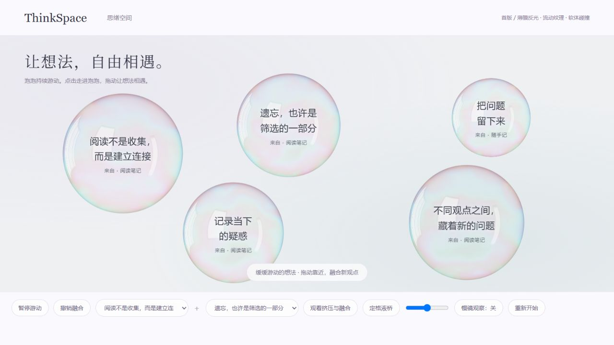
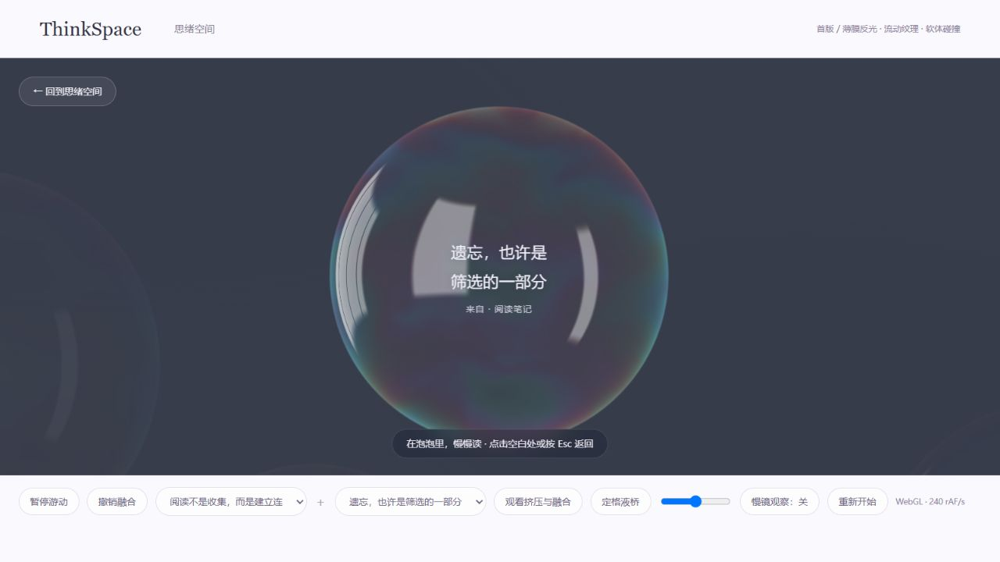
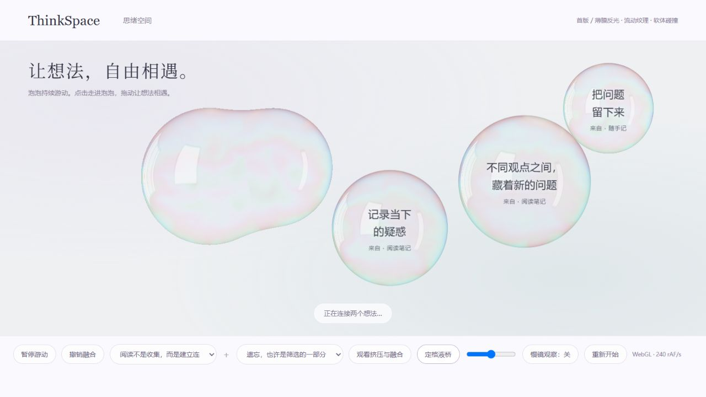
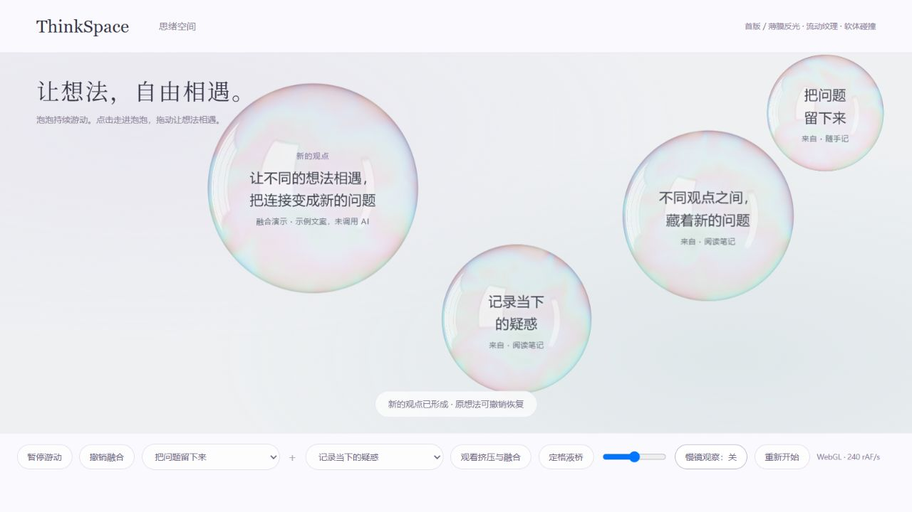

# 灵感泡泡动画组件：第一版

版本：0.1.0；日期：2026-11-15。

本次提交把独立动画组件加入 `packages/thought-bubbles`，供网页同学接入。现有 Vue 网页、OAuth 和浏览器扩展不在此次修改范围内。

## 体验与测试

打开 [demo.html](../../packages/thought-bubbles/demo.html) 的本地文件，或在仓库根目录运行：

```powershell
python -m http.server 8772 --bind 127.0.0.1 --directory packages/thought-bubbles
```

然后访问 `http://127.0.0.1:8772/demo.html`。GitHub 文件浏览器只能查看 HTML 源码，不会运行演示。

```powershell
node packages/thought-bubbles/tests/physics.cjs
```

## 首版行为

- 透明薄膜反光、虹彩纹理流动和缓慢漂浮；鼠标悬停不冻结、不变白。
- 每颗 64 个膜节点，以不大于 1/240 秒子步连续积分，挤压、鼓起和回弹都来自实时状态。
- 按变形后的边缘判定接触，1–3px 容差，拖动后松手即可融合；随机相遇不会自动合并想法。
- 三维隐式曲面液桥、逐帧弹簧吸引和合并后的膜振动。
- 点击泡泡：环境淡化、镜头推进，在透明泡泡内部阅读；按 Esc 或返回按钮退出。
- 演示提供慢镜和定格曲面检查工具；实际网站可以只使用组件 API。

接入方式和 API 见 [组件 README](../../packages/thought-bubbles/README.md)，模型依据见 [物理说明](../../packages/thought-bubbles/PHYSICS-NOTES.md)。

## 实际测试截图

以下图片从运行中的浏览器采集，不是效果图或截图生成器。

### 漂浮与膜材质



### 透明泡泡内景阅读



### 液桥形态检查



### 融合完成



## 验证范围

物理测试覆盖接触容差、接触侧凹入、自由侧鼓起、分离后的连续回弹与能量衰减。浏览器人工验证 WebGL 材质、拖动松手融合、内景进入退出和融合完成；截图只证明对应可见状态，不等于全平台性能验收。

此版本是实时薄膜光学和弹性膜近似，不是完整三维流体解算，也没有完成真实肥皂泡实验参数的数值拟合。示例生成文案固定，真实 AI 生成与持久化交给 `onMerge` 回调；OAuth 不影响独立演示运行。真实手机、跨浏览器与跨显卡性能仍待测试。
