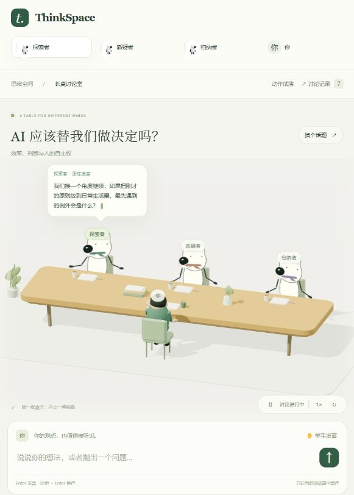
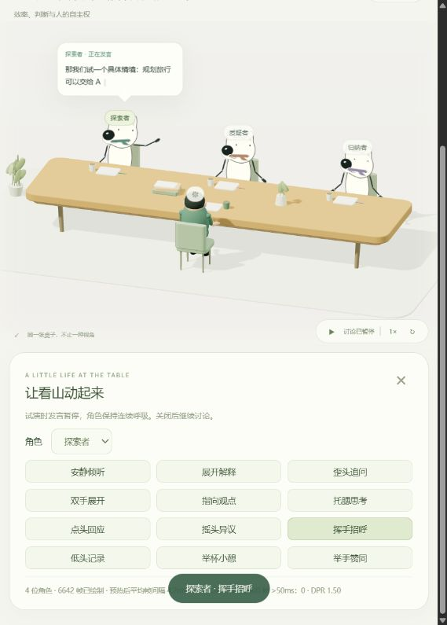

# 长桌讨论室 · 平面角色版 0.1.1

刘看山已改为分层平面插画：头、身体和手臂均为无厚度贴片，采用平面关节连续动画，并处于立体桌椅场景的真实深度中。用户角色及桌椅保持立体。

- [运行与接入](../../packages/debate-room/README.md)
- [测试与性能采样范围](../../packages/debate-room/VALIDATION.md)

4 项逻辑测试和语法检查通过；浏览器确认平面角色、发言接替及挥手试演。该轮采样最近 600 帧 P95 约 4.3ms，>50ms 为 0；仅代表本轮本机 rAF 采样，跨设备流畅性待验证。角色为参考素材制作的近似插画，示例讨论不连接 AI 或后端。

## 平面角色总览

## 平面关节挥手

01—03 截图为旧版留档，05—06 为当前版本。
