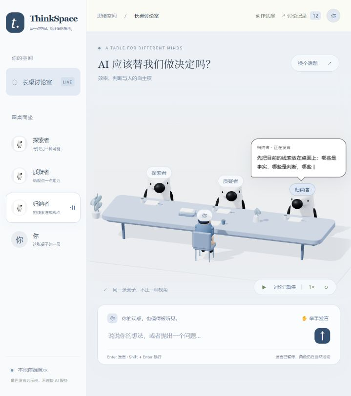
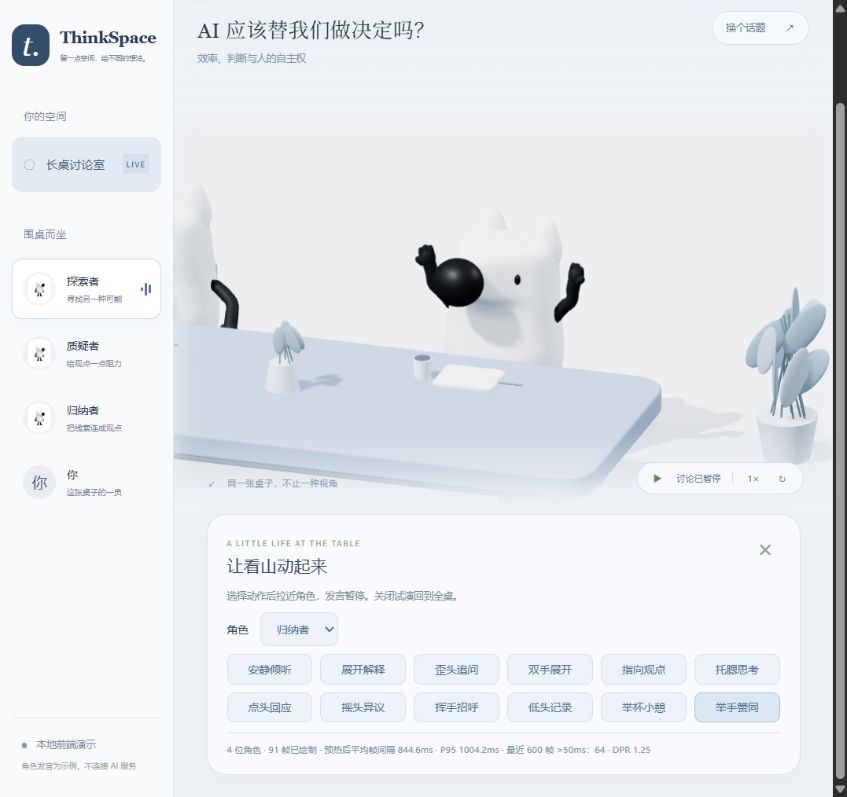
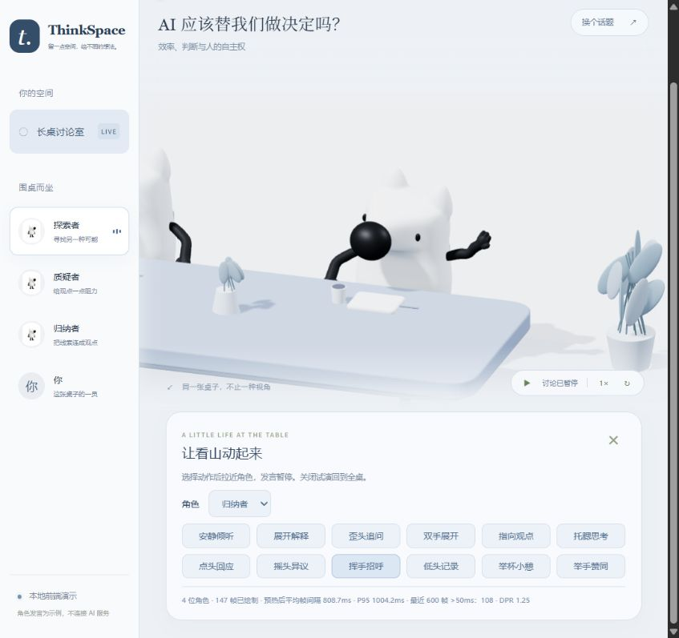
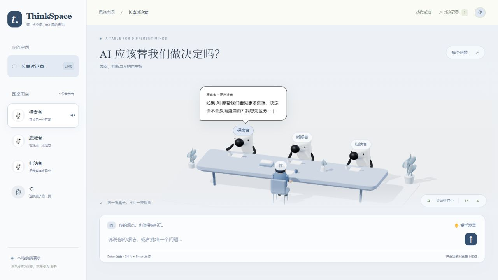
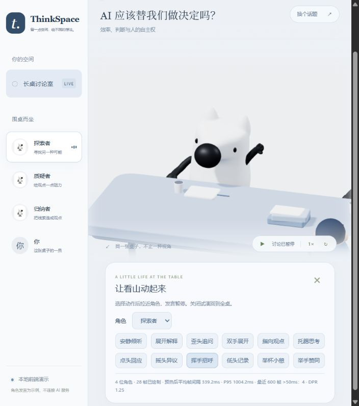
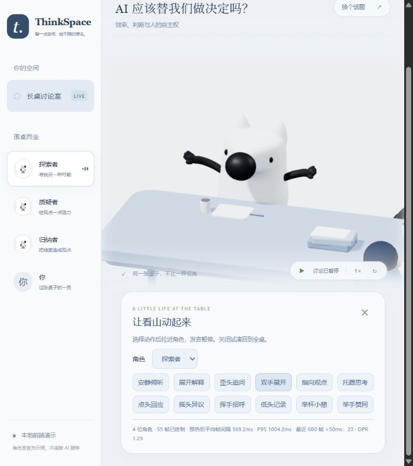
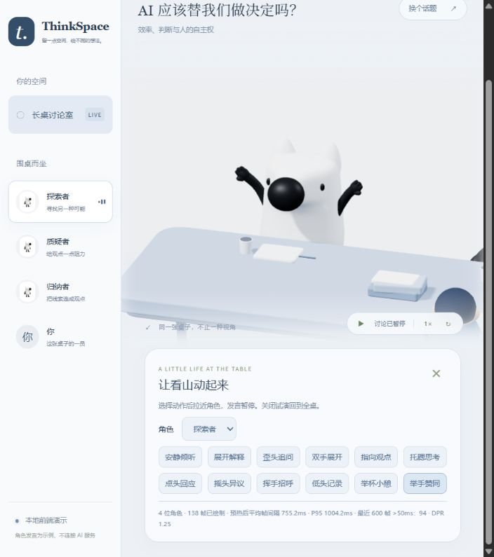

# 长桌讨论室 · 0.2.3 三维资源版

当前版接入已确认的刘看山三维模型，整体使用冷灰蓝主题。角色气泡白底黑字，用户气泡黑底白字。

- [前端启动和接入](../../packages/debate-room/README.md)
- [可编辑模型、高精度 GLB、建模源码与参考](../../assets/kanshan/README.md)
- [完整资源 ZIP](../../releases/thinkspace-resources-v0.2.3.zip)
- [11 项自动测试与实际验证范围](../../packages/debate-room/VALIDATION.md)

运行模型约 2.35 MB；共享几何和材质，各角色克隆独立骨骼。模型载入完成后进入讨论，模型失败会显示错误。示例讨论仍只在前端运行，不连接真实 AI 或后端。

## 正式讨论姿态

倾听、停顿与暂停时自然垂手，发言只短暂抬手后收回。不再自动悬空写字或举杯。完整动作保留在试演，未实现桌面接触解算。接入时保留 motion-policy.mjs 的收手调度。

## 肘部修正记录

双骨骼实时解算让左右肘保持朝外，避免举手时折向身体；保持臂长，并保留手部动作。10 项检查包含逐帧切换约束，禁用此修复时可复现原来的左肘内折。

## 动作修正

实际网格动作独立校准，移除二次幅度缩小；挥手保持在头部轮廓外，展开及举手越过桌面。修复低帧率时场景时间被截断造成的慢动作。动作试演平滑拉近角色，关闭返回全桌。

## 当前版本截图

此前 01—06 截图为旧版历史留档。
