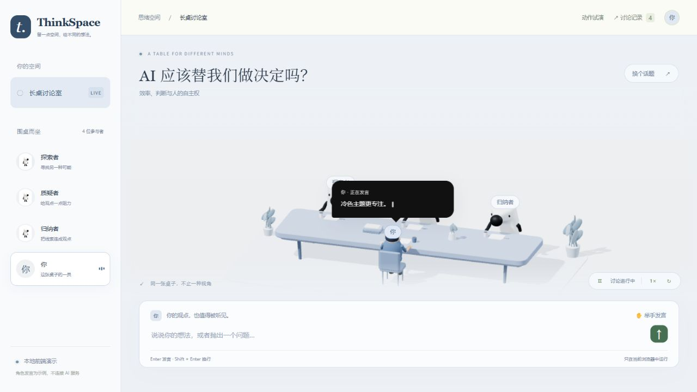
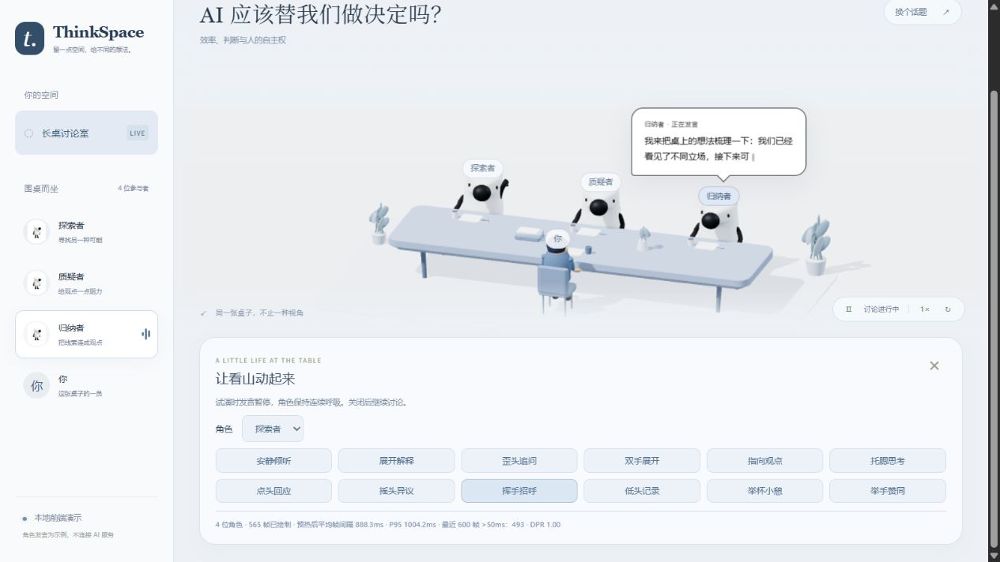

# 长桌讨论室 · 0.2.0 三维资源版

当前版接入已确认的刘看山三维模型，整体使用冷灰蓝主题。角色气泡白底黑字，用户气泡黑底白字。

- [前端启动和接入](../../packages/debate-room/README.md)
- [可编辑模型、高精度 GLB、建模源码与参考](../../assets/kanshan/README.md)
- [完整资源 ZIP](../../releases/thinkspace-resources-v0.2.0.zip)
- [7 项自动测试与实际验证范围](../../packages/debate-room/VALIDATION.md)

运行模型约 2.35 MB；共享几何和材质，各角色克隆独立骨骼。模型载入完成后进入讨论，模型失败会显示错误。示例讨论仍只在前端运行，不连接真实 AI 或后端。

## 当前版本截图

此前 01—06 截图为旧版历史留档。
