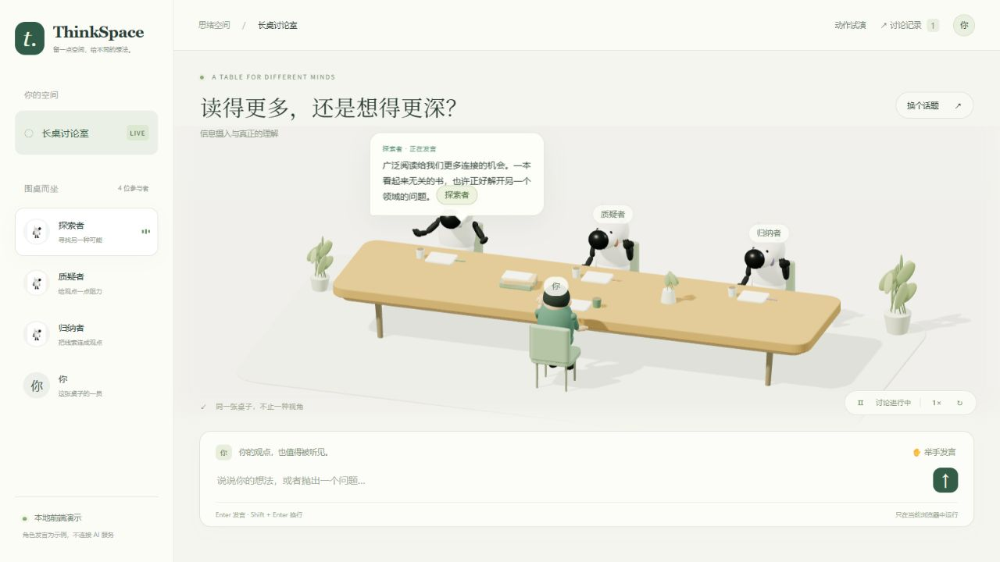
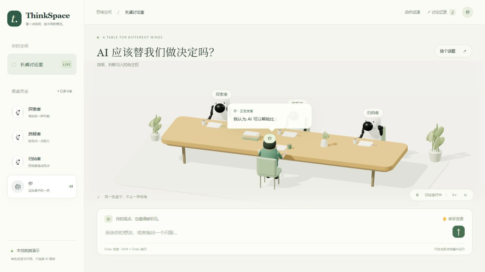
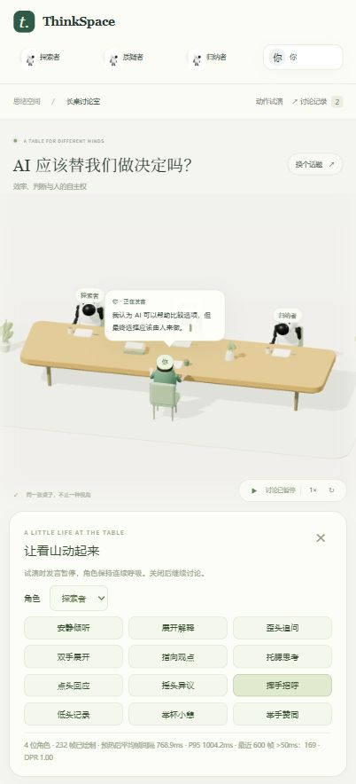

# 长桌讨论室前端首版

独立模块：[运行与接入说明](../../packages/debate-room/README.md)。验证：[完整记录与性能限制](../../packages/debate-room/VALIDATION.md)。

4 项逻辑测试通过，浏览器验证了发言输入、角色接替、动作选择、话题切换和讨论记录。内嵌浏览器采样存在约 1 秒一帧的节流现象，流畅性需要实际前台浏览器复测，不能视为性能验收通过。

角色是根据用户提供的刘看山参考图制作的程序化近似造型。纯前端预设讨论，不接入真实 AI、OAuth 或后端。

## 桌面总览

## 用户发言

## 窄屏完整动作试演页

