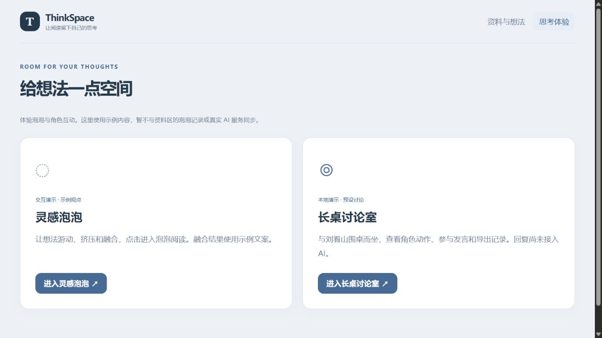
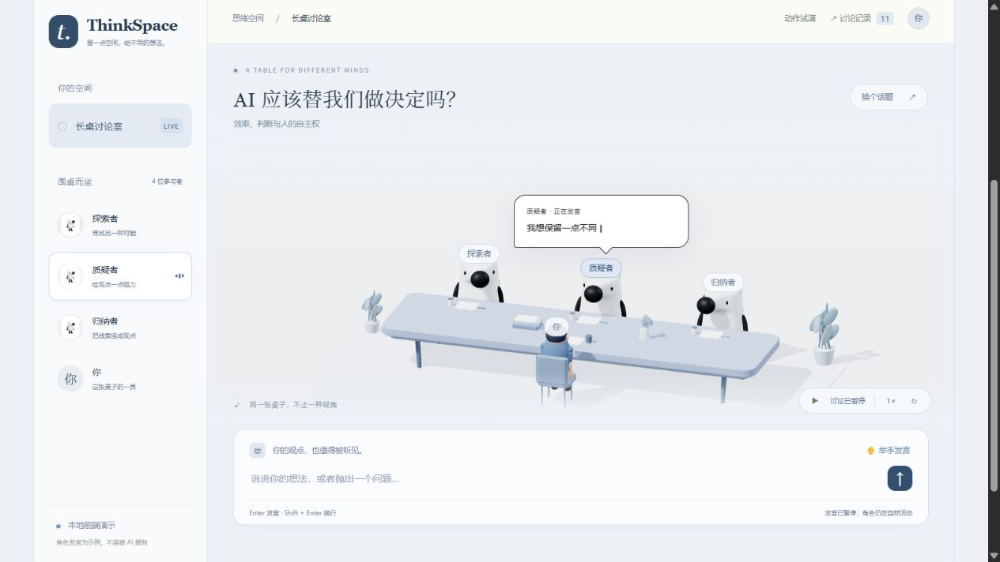
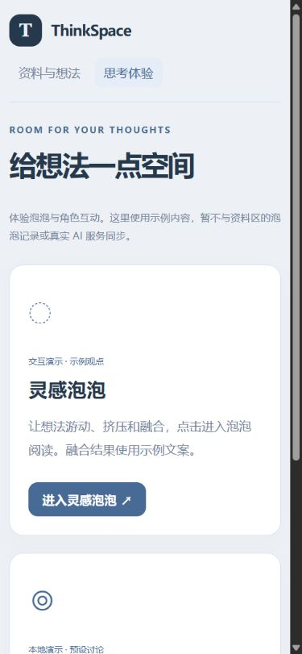

# 网站 review 与修整记录（2026-11-18）

基于 `main` 的 `e9e1af9` 检查，修改分支 `review/site-integration-2026-11-18`。沿用现有 Vue/FastAPI/SQLite，无新增业务依赖、数据库表结构或公共接口变化。

## 发现与修复

| 优先级 | 触发方式与原行为 | 本次处理 |
|---|---|---|
| P1 | 同一浏览器从知乎账号 A 改登 B，回调沿用 A 的本地用户并覆盖 profile，B 可见 A 的私有记录 | 根据提供方验证后的 UID 解析本地用户；不同 UID 不接管已绑定用户；绑定与会话建立置于同一事务 |
| P1 | 同一知乎账号在新浏览器授权，创建新本地用户，找不到原先记录 | 同 UID 查找已有本地用户；`BEGIN IMMEDIATE` 避免并发登录重复创建 |
| P2 | 快速切换文章、收藏详情或退出登录时，旧请求可在新选择之后回填数据 | 请求范围取消与有效性检查；退出立即清空私有缓存及配对码；组件卸载后不再回填 |
| P2 | 后端不可用时未登录页面缺少错误提示；错误重试可能请求了其他端点 | 增加匿名页错误提示、非 JSON 响应错误说明、按实际失败操作重试；分页分别保留错误与 offset |
| P2 | `with sqlite3.Connection` 只提交/回滚事务，不关闭连接；Windows 下文件仍被占用 | 封装连接上下文并在 finally 关闭；增加文件释放检查 |
| P2 | 主站没有泡泡及三维讨论室入口，独立演示难以作为同一网站交付 | 新增「思考体验」，只挂载当前演示；开发及构建复用组件资源，白名单排除源码、截图和测试 |
| P2 | 页面与交接文档把未完成的真实 OAuth 联调说成已验证 | 明确模拟资料、示例融合、预设讨论和真实接入的边界，移除填 key 即完成的承诺 |

主站色调调整为冷灰蓝；保留现有资料布局和两个组件的材质、模型与物理实现。

## 账号问题复现

使用模拟提供方替代外部知乎响应，走实际回调和 SQLite 保存逻辑；不涉及真实账号或生产数据。

| 检查 | 修复前 | 修复后 |
|---|---|---|
| 同 UID 跨浏览器得到同一本地用户 | 否 | 是 |
| 第二浏览器找回该账号的记录 | 否 | 是 |
| 切换 UID 保持独立本地用户 | 否 | 是 |
| 新账号能看到旧账号私有记录 | 是 | 否 |

另验证并发 8 次登录仅产生一个用户、不能删除其他账号记录、未绑定演示用户可首次绑定，以及既有正式账号不自动合并另一演示用户的数据。

## 实际验证

| 命令或操作 | 结果 |
|---|---|
| `.\.venv\Scripts\python.exe -m pytest api/tests -q` | 16 项通过；有一条当前 Starlette/httpx 测试适配的弃用警告 |
| `npm --prefix web test` | 8 项通过：请求失效、API 错误、运行资源白名单与打包 |
| `npm --prefix web run build` | Vue 类型检查及生产构建通过 |
| `npm --prefix packages/thought-bubbles test` | 融合间距、连续膜节点形变与恢复检查通过 |
| `npm --prefix packages/debate-room test` | 11 项通过 |
| 构建预览 HTTP 检查 | 首页、API health、两个演示页面、泡泡脚本、Three.js 与 GLB 共 7 个路径返回 200，GLB 文件头正确 |
| 浏览器资料流程 | 演示登录、用户页、关注 5→8、创作 5→10→12 分页、退出后移除资料通过 |
| 浏览器体验流程 | 未登录可进入体验，泡泡加载及内景阅读、讨论室模型显示及暂停通过 |
| 手机宽度 390px | 入口变为单列；入口与内嵌外层无横向溢出。仅桌面浏览器模拟宽度，未做真机触控验收 |
| 构建预览控制台 | 本次读取的 error/warn 为空 |
| `npm audit --omit=dev --json` | 运行依赖 0 告警 |
| `npm audit --json` | 3 个中危依赖节点，关联同一个 minimatch 开发工具链公告，待兼容升级 |

网页测试使用现有 TypeScript 转译运行，未引入测试框架。浏览器验证使用隔离的临时数据库及演示配置，不写真实资料。截图证明布局及加载，不证明高帧率或物理视觉验收。

## 页面证据

## 遗留与交接

1. 旧版本可能已产生重复用户或混合归属数据。本次按 UID 优先选择创建时间较早的已有用户，阻止继续覆盖其他 UID；不会猜测并迁移旧记录。存在真实存量时需后端负责人先备份，再审计归属、确定恢复方案。
2. 真实知乎授权、资料访问与令牌生命周期未联调，不能据此认定可生产上线。扩展实机流程本次未重新验收。
3. 动画融合使用示例文案；讨论室回复为预设内容；尚未与真实泡泡保存、观点生成或 AI 服务对接。
4. 开发工具链的 minimatch 告警位于 `vue-tsc → @vue/language-core → minimatch`，公告编号 `GHSA-g3hv-75wg-m249`。npm 提议升级 vue-tsc 主版本；本次保留原依赖，后续单独升级并验证类型兼容性。运行依赖审计 0 不代表完整安全审计通过。
5. 未进行公网部署、真实设备流畅度验收、长时间负载或完整渗透检查。当前构建按域名根路径部署；生产环境还需 HTTPS/Cookie 与 API 代理配置。
