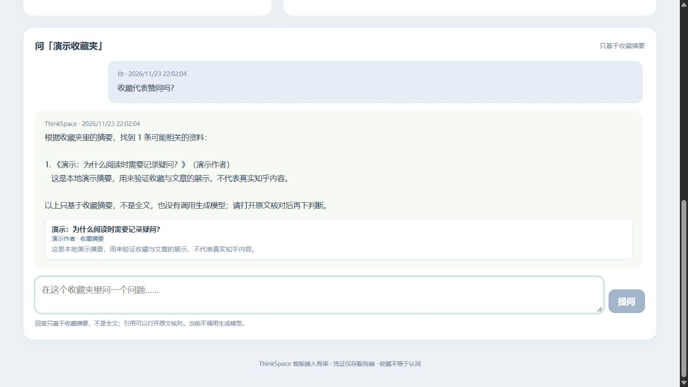

# PR #2 合并冲突处理 · 2026-11-23

将主分支 `2bf8f12` 合入 PR #2 的 `e101f46`，更新原 PR 分支，不直接合并 PR 到 main，不改写历史。

## 冲突原因与保留内容

冲突文件为 `README.md`、`docs/TEAM-HANDOFF.md`、`web/src/App.vue`。主分支新增收藏夹问答状态、收起交互和界面，PR 分支同时调整首页请求生命周期，并合入了 PR #4 的思维泡泡正式页。

- 首页保留主分支的收藏问答、收藏夹展开/收起、摘要引用和历史消息恢复。
- 保留 PR 分支的请求取消及有效性检查、账号数据清理、删除最后一颗泡泡的事务处理，以及泡泡正式页、思想分叉和讨论室入口。
- 文档合并功能说明，保留真实 OAuth/AI 未联调的边界，避免沿用主分支旧的测试数量作为本次结果。
- 自动合并主分支的 QA 服务、路由、SQLite 存储、类型和样式；没有修改公共接口。

## 额外语义检查

问答创建会话与提问分别使用 `RequestScope`。收起/切换收藏夹、切换标签、清理账号数据和卸载时取消并失效请求。成功、异常和 finally 都检查请求有效性，防止旧请求覆盖新会话的内容、错误或忙碌状态。收藏条目请求同时保留取消与过期响应保护。

新增 3 项网页集成回归，运行实际 App setup 中的逻辑，覆盖：

1. 收起后迟到的收藏条目/会话不能回填。
2. 旧提问失败不能污染新会话的错误或忙碌状态。
3. 切换标签和卸载后，旧提问成功也不能恢复私有消息。

## 本次验证

| 检查 | 实际结果 |
| --- | --- |
| API `pytest api/tests -q` | 97 项通过；现有 Starlette/httpx 弃用提示 1 条 |
| 网页 `npm --prefix web test` | 22 项通过 |
| `npm --prefix web run build` | 类型检查与生产构建通过 |
| 泡泡组件 | 物理检查与 4 项生命周期测试通过 |
| 讨论室组件 | 11 项通过 |
| 本地浏览器 | 隔离测试库中演示登录、展开收藏夹、提问显示摘要与引用、收起与恢复历史均通过；泡泡与思想分叉页面可进入；控制台未观察到错误 |

浏览器使用无真实凭证的演示账号和独立测试库；这不证明真实知乎授权、真实数据或生成模型已接通。截图记录界面结果，不构成回答质量验收。
