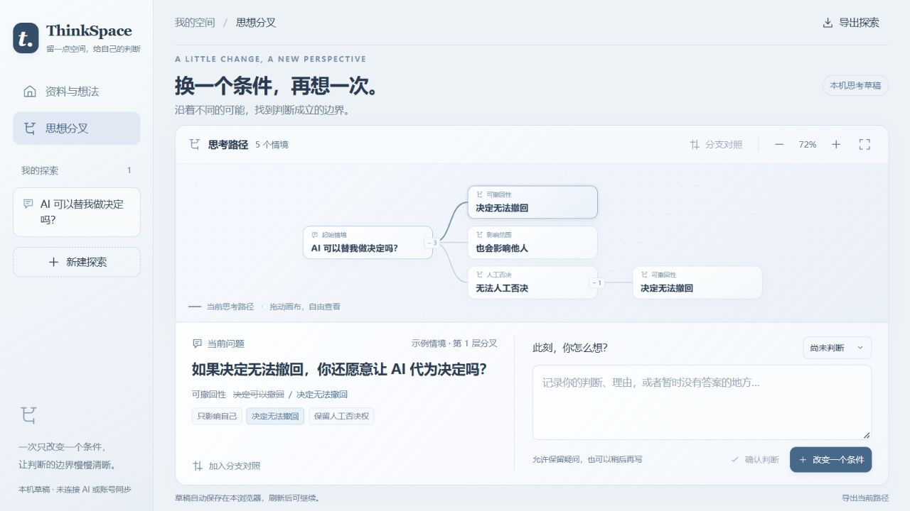
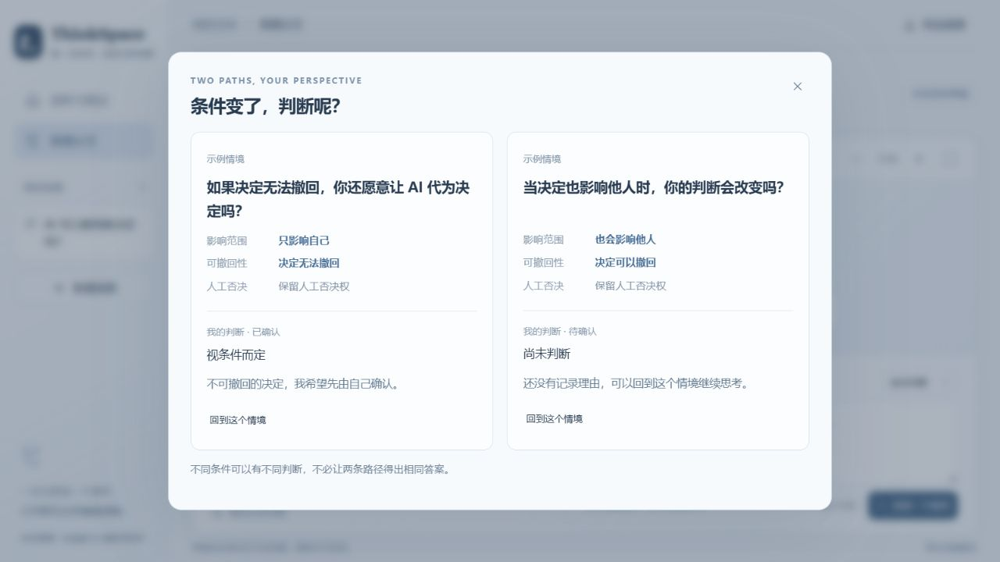

# 思想分叉前端首版

日期：2026-11-19。基于主分支 `53c2dc7`，独立分支 `feat/thought-branches`。沿用 Vue 3 / TypeScript / Vite，无新增依赖，不修改服务端和现有公共接口。此前网站 review 的 PR #2 尚未合并，本分支不依赖其中的改动。

当前状态：**本地交互实现与浏览器检查完成，未接入真实 AI、账号同步、收藏引用或讨论室业务联调。** 初始五个情境是固定示例，没有自动生成回答。

## 运行

从仓库根目录运行：

```powershell
npm --prefix web ci
npm --prefix web run dev
```

打开 `http://localhost:5173/thought-branches`，也可从主站顶部「思想分叉」进入。分叉页面可以独立使用，不需要 API 或 OAuth；原资料页面仍按原流程连接后端。

```powershell
npm --prefix web run test:branches
npm --prefix web run build
```

部署时需要将 `/thought-branches` 路径回退到网页 `index.html`，Vite 开发及预览服务器已支持。当前路径以域名根目录部署为前提。

## 页面和交互

- 整页统一冷灰蓝。上方树画布，下方常驻「当前问题」框；选择节点立即更新问题、条件变化、继承条件及自己的判断。
- 每个节点代表一种情境。同一分支每次只改变一个已有条件，其余条件复制父节点快照；原节点、同级分支及判断保持独立。
- 「改变一个条件」由用户填写变化和新问题，确认后创建节点。示例、自建情境均有标记。
- 判断文字自动作为本机草稿保存，用户点击「确认判断」才标记为已确认；之后再编辑会回到草稿状态。
- 选择两个节点加入对照，比较三个条件和用户判断；不同条件用同一灰蓝强调，不标记正确或错误。
- 支持折叠、展开、拖动画布、按钮缩放。画布获得焦点后，方向键平移，Home 适应画布。窄屏默认聚焦当前节点，可拖动查看其余路径。
- 「新建探索」保留已有探索，并允许自定义三个起始条件。首版每个探索最多 64 个节点，本机最多 30 个探索。
- 可导出全部探索 JSON，以及当前祖先路径 Markdown。JSON 导入暂未提供；导出的文件可用于备份与人工交接。

## 数据边界与接手位置

数据保存在当前浏览器的 `localStorage`，键名为 `thinkspace:thought-branches:v1`。同一浏览器与源下共享草稿，不按登录账号隔离，不上传服务器。切换端口、浏览器或设备不会自动带走记录，清理浏览器存储会影响草稿。

加载时校验版本、单根树、父链、唯一 ID 和单条件变化。发现不支持或损坏的旧草稿时，保留原存储并停止覆盖，当前页可继续探索和导出。配额不足或存储不可用时显示未保存提示，不宣称成功同步。

| 文件 | 用途 |
|---|---|
| `web/src/branches.ts` | 节点与条件类型、单条件分叉、祖先路径、布局、草稿校验、Markdown 导出 |
| `web/src/components/ThoughtBranches.vue` | 页面状态、草稿保存、画布、问题框及编辑/对照弹窗 |
| `web/src/thought-branches.css` | 局部冷色样式、桌面与手机布局、减少动态效果偏好 |
| `web/src/components/BranchIcon.vue` | 本页 SVG 图标 |
| `web/tests/branches.test.mjs` | 节点继承、条件约束、存储校验、折叠及路径导出检查 |

后端接入时可参考 `BranchDraft → Exploration → BranchNode` 的数据关系，但这不是已确认的公共 API。节点保留父 ID、完整条件快照和本次变化；用户判断和确认状态单独存储。来源文章、来源泡泡、讨论消息关联、权限隔离和 AI 情境生成仍需与对应负责人约定，不能将本机 UUID 当作服务端授权依据。

## 实际验证

- `npm --prefix web run test:branches`：6 项通过。
- `npm --prefix web run build`：类型检查和生产构建通过。
- 浏览器实际创建第二层分支，确认父条件继承、下方问题框同步；填写倾向与理由并确认，刷新后恢复节点、倾向及文字。
- 两分支对照显示不同条件、已确认及待确认判断。
- 新建「读研还是直接就业？」并自定义经济、兴趣、就业三个起始条件，原探索保留，刷新仍可读取。
- 折叠隐藏后代并切换至父节点，展开恢复；缩放与键盘平移通过。
- 下载 Markdown，读取文件确认包含当前路径和已确认的用户判断。
- 390px 桌面浏览器模拟手机宽度，页面无横向溢出，树和问题框上下排列。未完成真机触控验收。
- 当前分叉页读取的控制台 error/warn 为空。未重新验收无关的后端、扩展、泡泡与三维讨论室。

以下为实际运行截图。额外节点、判断及第二个探索均为手动输入的测试内容，不是真实用户记录。






