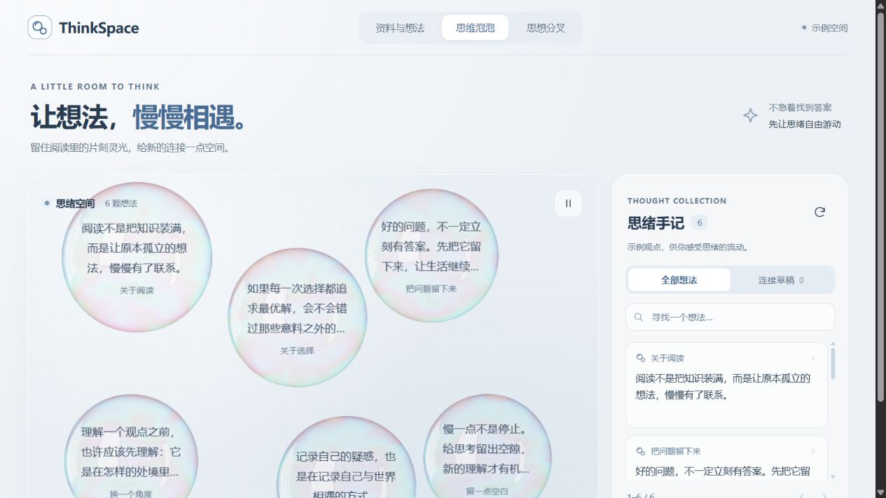
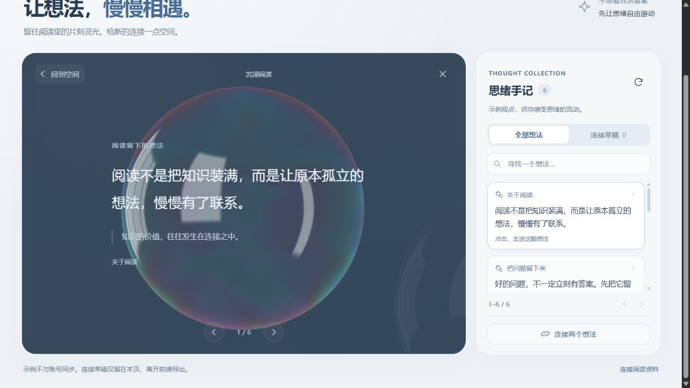
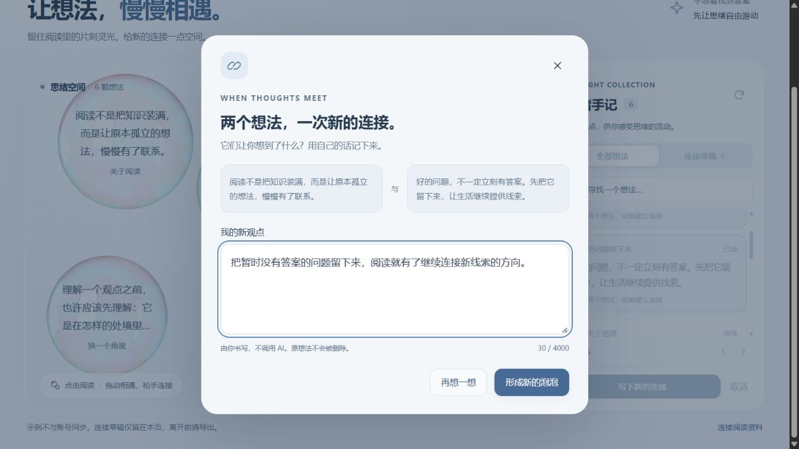
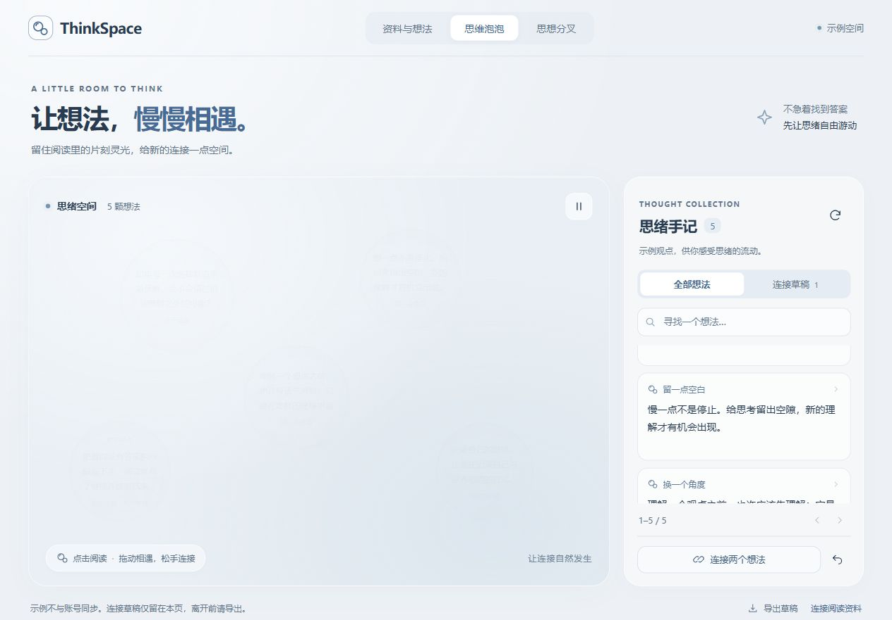
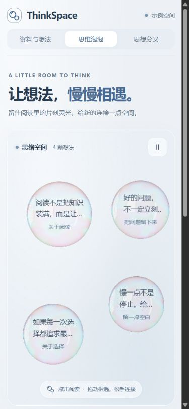

# 思维泡泡 · 页面与交互

2026-11-22。本地前端已实现，并与现有本地 API 读取链路联调；真实知乎 OAuth、真实模型与手机/跨显卡性能仍待验收。此页基于网站整合分支，PR #2 合入前，本次 PR 以该分支为 base。

## 进入与数据

按根 README 启动 API 和网页，从主导航、思考体验或思想分叉侧栏进入「思维泡泡」，地址为 `/thought-bubbles`。沿用 Vue 3 / TypeScript / Vite 和原有 WebGL 包，没有新增依赖或修改后端接口。

- 先请求 `GET /api/auth/status`，已登录时请求 `GET /api/bubbles`，只展示当前账号返回的记录。请求失效、离开页面时取消请求，失效响应不落入页面。
- 未登录时展示明确标注的示例。账号内没有记录时展示空状态，不向账号或数据库写入示例。后端错误展示重试和「先看示例」，不把故障当作空数据。
- 手记支持正文、来源和引用搜索；桌面每组最多 6 颗，窄屏每组最多 4 颗。长文在阅读区滚动，知乎原文链接仅允许 HTTPS 知乎域名。
- 拖动接触后松手，或通过「连接两个想法」选择两条记录，打开连接编辑器。由用户填写 1–4000 字的新观点，确认后连续求解液桥融合。不调用 AI，不使用预设回复冒充新观点。
- **连接结果只留在当前页面内存中**，不写回服务器；原记录不删除。支持撤销最近一次连接和 Markdown 导出（含父观点）。刷新、重置、重新读取或离开页面会丢弃未导出的草稿。真正的连接关系存储/账号同步需要后端另行约定，不复用删除接口模拟。

## 动效与实现

| 交互 | 当前处理 |
| --- | --- |
| 进入/换组 | 透明度与尺度渐入，膜节点和薄膜纹理仍实时计算 |
| 泡泡移动 | 原有单 rAF 循环与连续膜节点求解；悬停无暂停处理 |
| 点击阅读 | 阻尼镜头靠近，环境和其他泡泡淡出；透明薄膜保留，不切换白底 |
| 阅读切换 | 卡片先淡出，再带轻弹性进入；镜头连续追踪新目标 |
| 返回 | 阅读内容淡出，镜头缓缓退回，恢复原画布 |
| 卡片/分类 | 按压回弹、透明度切换、分段滑块与列表 FLIP 位移；悬停不改变卡片高度 |
| 连接编辑 | 背景淡化、编辑卡片弹入；取消恢复焦点，Tab 约束在编辑器内 |
| 减少动态 | 遵循系统 `prefers-reduced-motion`：关闭 CSS 动效、自主游动及膜纹时间推进，融合直接完成 |

`web/src/components/ThoughtBubblePage.vue` 管数据、交互和无障碍焦点；`web/src/bubble-space.ts` 管资料映射、搜索、布局及连接草稿；`web/src/thought-bubbles.css` 管页面与过渡。

动画组件仍可独立使用。新增可选 `externalReader`、`onFocusChange(item|null)` 和 `animateEntrance`，正式页用独立 DOM 排版阅读内容，避免 Vue 逐帧重绘。既有演示保持内部阅读行为。

## 性能处理与边界

- 单 WebGL 画布，正式页 `maxDpr: 1.15`，按尺寸缩放泡泡并限制同屏数量。
- 着色器先做空间范围剔除，避开无关泡泡的膜纹纹理读取。
- 膜纹理只分配一次，后续用 `texSubImage2D` 更新；缓存文字节点，直径未变化时不重复设置尺寸。正式页镜头由引擎驱动，文字由 Vue 的低频状态切换驱动。
- 去掉逐帧 DOM 模糊滤镜。后台不绘制，销毁时取消帧循环、断开 ResizeObserver、释放 WebGL 资源；等待中的编辑器在页面卸载时拒绝并清理。
- WebGL 不可用时组件降级 CSS，无法保留曲面反光与液桥。该模型仍是实时光学和软体近似，不是完整流体求解。
- 开发态通过页面 `data-renderer` / `data-raf` 提供低频观察值。rAF 回调频率不能等同于 GPU 帧率或全设备不卡顿保证，生产构建不启用该诊断定时器。

## 本次验证

| 检查 | 实际结果 |
| --- | --- |
| `npm --prefix web test` | 19 项通过，包含资料映射、来源链接约束、过滤、草稿父关系与场景数量约束 |
| `npm --prefix web run build` | 类型检查和生产构建通过 |
| `npm --prefix packages/thought-bubbles test` | 连续形变/接触阈值检查通过，4 项生命周期检查通过 |
| `python -m pytest api/tests -q` | 89 项通过；现有 Starlette/httpx 弃用提示 1 条 |
| 浏览器：开发版与构建版 | 打开、阅读、切卡、返回、拖动接触、取消连接、用户填写后融合、撤销、导出均操作通过 |
| 本地 API | 独立测试数据库与演示会话验证空状态、8 条测试记录读取、分组、搜索、长文滚动与原文链接；未触碰真实数据 |
| 窄屏 | 390px 预览设置下每组 4 颗，下一组 2 颗，无水平溢出；不是手机实机验收 |
| 服务故障 | 关闭本次测试 API 后，构建版正确展示错误，仍可主动进入示例空间 |

截图为实际运行画面，只记录视觉状态，不作为帧率证明：

部署仍需同域 `/api/` 代理；直接访问 `/thought-bubbles`、`/thought-branches` 时，静态服务器需要回退到 `index.html`。勿把 API 或资源 404 也重写为 HTML。
